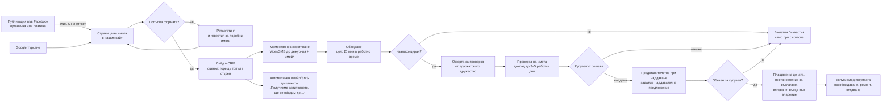

# „Бащина къщурка“: анализ и идеи (Фаза 1)

**Дата на анализа:** 13.11.2026
**Статус:** само анализ. Нищо не е публикувано, регистрирано, платено или извлечено автоматично.

---

## 0. Резюме и какво не беше изпълнено

### Кратко резюме

1. **Пазарът е по-малък, отколкото изглежда.** Към 13.11.2026 активните обяви за имоти от ЧСИ са **1 350**, но **около 61 % от тях са земя и парцели**. Жилищата (апартаменти и къщи) са **около 280** в цялата страна. Апартаментите са около 150 ([TenderBulgaria, имоти](https://tenderbulgaria.com/publichni-prodazhbi/imoti/)). Сегментът „бащина къща“ е **около 130 обяви** в цялата страна във всеки момент.
2. **Самата информация е безплатна и вече се агрегира.** Агрегатор е сайт, който събира обяви от много източници на едно място. TenderBulgaria показва всички обяви на КЧСИ безплатно, обновява ги всеки час и праща безплатни известия по имейл. Платен абонамент за известия **не е смислен** модел.
3. **Стойността е в правната част, а не в обявата.** Купувачът няма продавач, който да плаща комисионна, затова плаща само купувачът. Той ще плати за риск, който не може да прецени сам. Примери от реалните обяви по-долу: право на ползване в полза на трето лице, имот в делба, разминаване в площите. Препоръчвам ядрото на модела да е **платена проверка + представителство при наддаване**. Агенцията да е фуния за привличане на клиенти, а не основен източник на приход.
4. **Правно:**
   - От ДВ бр. 17/2026 рекламата на адвокати е **разрешена** (нов чл. 42 ЗА). Това отваря пространство, но с ограничения.
   - Агенцията трябва да е **отделно търговско дружество**, чийто управител не е адвокат.
   - Комисионна за агенцията, която зависи от покупката, поражда **реален конфликт на интереси** с адвоката, който съветва „купувай или не“.
5. **Автоматичното четене на sales.bcpea.org отпада като вариант без съгласие.** Сайтът е зад защита на Cloudflare срещу ботове. Предприети са технически мерки срещу автоматичен достъп.

### Какво не беше изпълнено и защо

Това е важно, защото критериите „готово е, когато“ не са изпълнени изцяло.

| Изискване | Статус | Причина | Какво трябва |
|---|---|---|---|
| А: преброяване на публикациите на lawyer.petrov за 90 дни, последователи, топ 10, Ad Library | **Не е изпълнено** | Тази сесия работи в облачен контейнер. Тук нямам Claude in Chrome с вашия вход. Facebook е недостъпен от контейнера. Поискахте Facebook да се разглежда само през вашия Chrome, затова не опитах заобиколни пътища. | Да пуснете Claude Code локално с Claude in Chrome, или да преброите ръчно по протокола в А.2. Попълва се таблицата в А. |
| sales.bcpea.org: ръчен преглед | **Частично** | Сайтът връща защита на Cloudflare („Just a moment…“). Не я заобикалях. | Обявите в раздел Г са взети от TenderBulgaria, който изрично посочва като източник КЧСИ / sales.bcpea.org. Преди публикуване ги проверете ръчно в оригинала. |
| Обявите на НАП (sales.nra.bg) | **Не е изпълнено** | Също зад Cloudflare. | Ръчен преглед от вас. |
| Марка: БПВ, EUIPO, TMview | **Не е изпълнено** | Регистърът на БПВ изисква вход и reCAPTCHA. EUIPO е в профилактика („temporary unavailable while applying security patches“). TMview отхвърля заявките през WAF (защитна стена на уеб приложението). | Ръчно търсене по линковете в Ж.1. Отнема 15 минути. |
| Домейн .bg | **Не е изпълнено** | register.bg е недостъпен от средата (грешка в TLS веригата през проксито). | Ръчна проверка в register.bg. |
| Домейн .com | **Изпълнено** | Проверено през RDAP на Verisign. RDAP е официалният публичен регистър „кой притежава домейна“. | Виж Ж.2. |
| TikTok | **Изпълнено** (с уговорка) | | Виж Ж.2. |
| Instagram, Facebook | **Не е изпълнено** | Instagram пренасочва към вход. Facebook е недостъпен. | Ръчна проверка. |

> За работата създадох отделна лична облачна среда „Amazon (bashtina-kashturka research)“. Тя има достъп само до изброените официални сайтове, сайтовете на конкурентите и регистрите. Не съм регистрирал, плащал или публикувал нищо.

---

## А) Образецът lawyer.petrov

### А.1 Таблица с метриките (за попълване)

| Метрика | Стойност | Източник / статус |
|---|---|---|
| Последователи на страницата | **не е проверено** | Изисква Facebook |
| От кога публикува продани | **не е проверено** | Първата публикация с обява от КЧСИ (скрол / „Търсене в страницата“) |
| Брой публикации 15.08.2026–12.11.2026 (90 дни) | **не е преброено** | Протокол в А.2 |
| Средно на ден | = брой / 90 | |
| Средно на седмица | = брой / 12,86 | |
| Дял на обявите за продан спрямо всички публикации | **не е преброено** | |
| Среден брой реакции / коментари / споделяния на публикация | **не е преброено** | |
| Активни реклами в Meta Ad Library | **не е проверено** | [Ad Library, BG, всички реклами](https://www.facebook.com/ads/library/?active_status=all&ad_type=all&country=BG&q=lawyer.petrov) |
| Групи, в които споделя | **не е проверено** | |
| Медийни участия | **не е намерено** | Две уеб търсения („адвокат Петров публична продан“) не откриха статии. Не може да се приеме, че няма такива. |

### А.2 Протокол за ръчно преброяване (около 60–90 минути)

1. Отворете страницата и изберете „Публикации“. Скролирайте до 15.08.2026, като на всеки 100 публикации записвате датата на последната видима.
2. В таблица записвате за **всяка** публикация: дата, вид (обява / образователна / лична / видео / reel), реакции, коментари, споделяния, накъде води линкът (sales.bcpea.org, негов сайт, Messenger, телефон). **Не записвате** имена на коментиращите. Това е изискването за без лични данни от коментари.
3. Топ 10: сортирате по реакции + коментари + споделяния и описвате общото. Например: вид имот, цена под определен праг, село или град, „шок цена“, история, снимка.
4. Ad Library: „Всички реклами“, държава България, търсене по името на страницата. Записвате брой активни и неактивни реклами, от кога, формат, призив към действие и дали има „Paid for by“ (данни за платеца).
5. В „Прозрачност на страницата“ се вижда датата на създаване на страницата и дали е сменяно името. Това показва дали аудиторията е събрана на нова страница или върху стара.

### А.3–А.7 Шаблон, ангажираност, аудитория, бизнес модел, слабости

Нито едно твърдение тук не е **видяно**. Всичко по-долу е **предположение** за проверка при ръчния преглед.

| # | Предположение | Как се проверява |
|---|---|---|
| 1 | Обявата е кратък текст: вид имот, град, начална цена, срок + снимка от КЧСИ + линк към sales.bcpea.org или към коментар | Шаблон от 3–5 обяви |
| 2 | Ангажираността идва от много ниски начални цени (селски къщи под €10 000) и от споделяния | Топ 10 |
| 3 | Аудиторията е изградена главно органично, тоест без платена реклама, чрез споделяния. Възможни са и реклами | Ad Library |
| 4 | Печели от адвокатски услуги (консултация, представителство), а не от самите обяви | Раздел „Услуги“, закачена публикация, сайт, отговори в Messenger |
| 5 | Контактът е през Messenger / телефон. Няма собствен сайт за събиране на заявки | Къде водят линковете |
| 6 | Вероятни слабости: няма крайна цена с разходите, няма анализ на тежестите и рисковете, няма филтри и търсене, няма известия по критерии, няма проследяване на резултата от проданта | Сравнение с нашия формат в Г |

**Критично:** без А.1 не знаем колко голяма е реално аудиторията му и колко бързо е растяла. Препоръчвам да **не** се взема решение за рекламния бюджет, преди да са попълнени поне последователите, честотата и Ad Library.

---

## Б) Пазарът

### Б.1 Обем

| Показател | Стойност | Източник | Бележка |
|---|---|---|---|
| Активни обяви на ЧСИ (всички видове) | **1 591** | [TenderBulgaria](https://tenderbulgaria.com/publichni-prodazhbi/), обновено 13.11.2026 10:52 | Видяно |
| от тях имоти | **1 350** | същото | Видяно |
| Нови обяви за 48 часа (всички видове) | **61** | същото | Видяно. Приблизително **30 на ден, ~900 на месец**. Това е приблизителна оценка от една моментна снимка. |
| Изтичат до 7 дни | 247 | същото | Видяно |
| Обща начална цена на активните обяви | €153,9 млн. | същото | Видяно. Изкривена е от няколко обекта за над €17 млн. |
| Обявления за продан на имоти, 2017 / 2018 | 46 545 / 37 024 | [Profit.bg](https://profit.bg/article/2024012507032789898) | По данни на КЧСИ. Включват повторните продани на същия имот. |
| Продадени имоти, 2024 | **3 055 или 3 900** | [Investicia.bg](https://investicia.bg/kamara-sudebni-izpulnitelni-295-mln-lv-subrani-polza-bankite) | Статията е **вътрешно противоречива**. Трябва да се провери в годишния отчет на КЧСИ. |

**Месечна динамика:** не е видима. Нито КЧСИ, нито TenderBulgaria публикуват серия по месеци, а sales.bcpea.org е недостъпен. Предлагам във Фаза 2 сами да записваме броя всяка седмица, ръчно, по 2 минути. След 3 месеца ще имаме собствена серия.

**Изводът, който има значение:** успешните продажби са около **250–330 на месец** за всички видове имоти (по данните за 2024 г.). Голяма част от обявите не се продават и се обявяват повторно.

### Б.2 Структура по вид имот (1 350 активни, 13.11.2026)

| Вид | Брой | Дял |
|---|---|---|
| Земеделска земя + земеделски имот | 651 | 48 % |
| Парцели | 176 | 13 % |
| Апартаменти (1-, 2-, 3-, многостайни, мезонети) | 148 | 11 % |
| Къщи (къща, къща/парцел с къща, етаж от къща, вила) | 132 | 10 % |
| Бизнес имоти (производствени, търговски, складове, офиси, хотели и др.) | около 135 | 10 % |
| Гаражи, паркоместа, други | около 98 | 7 % |

Източник: филтър „Тип“ в [TenderBulgaria, имоти](https://tenderbulgaria.com/publichni-prodazhbi/imoti/). Видяно.

### Б.3 Разпределение по области (топ 8, само имоти)

| # | Област | Обяви |
|---|---|---|
| 1 | Варна | 155 |
| 2 | Бургас | 117 |
| 3 | Пазарджик | 113 |
| 4 | Плевен | 99 |
| 5 | Пловдив | 88 |
| 6 | София (столица) | 80 |
| 7 | Смолян | 78 |
| 8 | Стара Загора | 73 |

Източник: същата страница. Видяно. Пълната разбивка по 28 области е на картата в сайта.

**Извод:** София е едва 6-а. Купувачите с пари са концентрирани в София, Пловдив и Варна, а голяма част от имотите са в провинцията. Това е едновременно възможност (софиянец, който търси къща на село) и разход (огледи и представителство извън София).

### Б.4 Конкуренти

| Конкурент | Тип | Какво предлага | Заплаха |
|---|---|---|---|
| [TenderBulgaria](https://tenderbulgaria.com/publichni-prodazhbi/) (ИНСАЙДМАПС БЪЛГАРИЯ ЕООД) | Агрегатор | Всички обяви, снимки („Снимки: КЧСИ, sales.bcpea.org“), карта, филтри, цена на кв.м, данни за ЧСИ, PDF на обявлението, **безплатни известия** по филтри, проверка „всеки час“. Имената на длъжниците са заменени с „[лице]“. Не дава правни съвети („не е страна в продажбата“). | **Висока** за информационната част. Нашият сайт ще изглежда като копие, освен ако не добавим правен анализ. |
| lawyer.petrov | Facebook адвокат | Виж А | Висока за аудиторията |
| izpalniteli.com / xcv.bg („Национален регистър на публичните продажби“) | Частен агрегатор | Списъци с продажби. В снимки от търсачката се виждат 844–1 479 активни. | Средна. Сайтът не се зареди при опит. |
| alo.bg и други сайтове за обяви | Обяви | Над 1 000 обяви по „ЧСИ“ ([alo.bg](https://www.alo.bg/searchq/?q=%D0%B8%D0%BC%D0%BE%D1%82%D0%B8+%D0%BE%D1%82+%D1%87%D1%81%D0%B8)) | Ниска |
| Сайтове на съдилищата (напр. [ОС Пловдив](https://plovdiv-os.justice.bg/bg/3919), [СГС](https://sgs.justice.bg/bg/12529)) | Официални | Обявления на ЧСИ | Ниска (неудобни) |
| Адвокатски кантори със съдържание по темата (напр. [kk-law.eu](https://kk-law.eu/), [innovires.com](https://www.innovires.com/blog/publichna-prodan-chsi-procedura-dluzhnik-gpk.html)) | SEO съдържание | Статии за процедурата | Средна за SEO, тоест за позициите в Google |
| Инвеститори и „препродавачи“ | Купувачи | Наддават срещу нашите клиенти | Не са конкуренти за услугата, но вдигат цената |

**Свободна ниша:** не открих играч, който съчетава (1) обява, (2) **правен анализ на тежестите и рисковете**, (3) **сметка на крайната цена** и (4) представителство и въвод. Това е нашето позициониране.

---

## В) Нашият сайт: концепция

### В.1 Структура и SEO

SEO (оптимизация за търсачки) е работата сайтът да се показва високо в Google за търсенията на хората.

**Страници:**

```
/                                   начало: търсачка + „как работи“ + доверие (адвокатско дружество партньор)
/prodani/                           всички активни продани
/prodani/{oblast}/                  напр. /prodani/plovdiv/
/prodani/{oblast}/{grad}/           напр. /prodani/plovdiv/plovdiv/
/prodani/{vid}/{oblast}/            напр. /prodani/apartamenti/plovdiv/   ← основната SEO страница
/imot/{id}-{slug}/                  страница на имот, напр. /imot/3066-dvustaen-pleven-druzhba/
/arhiv/                             приключили продани (с резултат, ако е известен)
/kak-se-kupuva-ot-chsi/             ръководства (съдържание за SEO и доверие)
/kalkulator-krayna-tsena/           калкулатор на крайната цена
/proverka-na-imot/                  услугата (страница на адвокатското дружество или препратка)
```

**Филтри:** област, град/село, вид имот, начална цена (от–до), площ, **срок на проданта** (изтича до 7 / 14 / 30 дни), „нови за 48 ч“, **ниво на риск** (наш етикет, добавен след проверка).

**SEO за търсения като „публична продан апартамент Пловдив“:**
- **Landing страници по вид × област.** Landing е страница, създадена специално за едно търсене. Пример: `/prodani/apartamenti/plovdiv/` със заглавие „Апартаменти на публична продан в Пловдив — актуални обяви от ЧСИ“. Отделни страници за всяка комбинация събират търсенията с „дълга опашка“: по-конкретни, по-рядко търсени, но с висока готовност за покупка.
- **Уникален текст.** Google наказва страници, които са само копие на чужди данни, като „thin content“ (тънко съдържание). TenderBulgaria вече има същите обяви. За да ни класира, Google трябва да вижда нещо, което другите нямат: нашия анализ на риска, сметката на крайната цена и местния контекст.
- **Структурирани данни (schema.org).** Това е машинно четим код в страницата, който обяснява на Google какво е на нея (цена, адрес, дата). Ползваме `RealEstateListing` / `Offer` / `Event` със срока на проданта.
- **Архив вместо изтриване.** Изтичащите обяви не се трият, а отиват в архив с надпис „Проданта е приключила“. Така страницата пази позициите си в Google и показва историята на цените.
- **Скорост и мобилен изглед.** Над 80 % от трафика от Facebook идва от телефон.
- **Блог / ръководства.** Целят въпроси като „как се купува имот от ЧСИ“, „какво е задатък“, „какво е въвод във владение“, „рискове при публична продан“.

### В.2 Форма за лийд на страницата на имота

Лийд е потенциален клиент, който е оставил данни за контакт.

**Задължителни полета:** име, телефон, имейл.

**Отметки:**
- ☐ Задължително: „Запознах се с Информацията за обработване на лични данни“ (линк). Това **не е съгласие**, а потвърждение, че е информиран (виж Д.4).
- ☐ Незадължително и отделно: „Искам да получавам нови обяви по имейл“ (съгласие за маркетинг).

**Квалифициращи въпроси.** Помагат да се прецени колко сериозен е интересът. Всички са с бутони, без свободен текст, за да се попълват бързо:

| Въпрос | Варианти | Защо |
|---|---|---|
| Какво искате? | Проверка на този имот / Представителство при наддаване / Само информация / Оглед | Насочва към услугата |
| Бюджет до | < €30 000 / 30–80 хил. / 80–150 хил. / > €150 000 | Отсява нереалистичните запитвания |
| Финансиране | Собствени средства / Кредит, одобрен / Кредит, неодобрен / Не знам | **Най-важният въпрос.** Цената се плаща в кратък срок след обявяването на купувача (чл. 492 ГПК). Купувач без пари в наличност е риск. |
| Кога искате да купите | До 1 месец / 1–3 месеца / Проучвам | Спешност |
| Купували ли сте от публична продан? | Да / Не | Колко обяснение е нужно |

**Оценка на лийда.** Всеки лийд автоматично получава точки (lead score). Пример: собствени средства + до 1 месец + „представителство“ = **горещ**, обаждане веднага.

**Не питаме** за ЕГН, адрес, причина за покупка или семейно положение. Това е минимизация по чл. 5 ал. 1 б. „в“ GDPR.

### В.3 Поток на лийда

CRM е система за управление на клиентските контакти: таблица или програма, в която всеки лийд има статус, история и отговорник.



UTM етикетът е добавка към линка, напр. `?utm_source=facebook&utm_campaign=plovdiv`. Показва от коя публикация е дошъл всеки лийд.

Ретаргетинг е реклама, която се показва повторно на хора, които вече са били на сайта. Изисква съгласие за бисквитки, виж Д.4.

**Целево време до обаждането:**

| Кога | Цел | Аргумент |
|---|---|---|
| Работно време (пон.–пет. 9–18 ч.) | **до 15 минути** | Изследванията на онлайн лийдове показват рязък спад на шанса за разговор след първия час. HBR, „The Short Life of Online Sales Leads“ (2011): фирмите, отговорили до час, квалифицират лийда около 7 пъти по-често. Тук има и твърд срок: проданта приключва на определена дата, а задатъкът трябва да е внесен преди нея. Освен това човекът най-вероятно е пратил запитване и до TenderBulgaria/ЧСИ, и до Петров. Първият, който се обади, печели. |
| Вечер и събота (18–21 ч., 10–14 ч.) | **до 2 часа** или SMS „ще се обадим утре до 10:00“ | Хората разглеждат Facebook вечер. Дежурство на смени за 2–3 часа е евтино. |
| Нощ и неделя | **до 10:00 на следващия работен ден** + моментален автоматичен SMS/имейл | Обаждане извън работно време е натрапчиво и изглежда неетично за адвокатски бранд. |
| Изключение | Ако срокът на проданта изтича до 72 часа, обаждане веднага в рамките на дежурството | Иначе клиентът изпуска проданта |

**Инструменти (без код във Фаза 1):** HubSpot Free, Pipedrive (~€15–30/потребител/месец) или Google Sheets + Make/Zapier в началото. Известяване: Viber бот или SMS през български доставчик.

### В.4 Набавяне на данните: три варианта

Важен факт от тази фаза: **sales.bcpea.org е зад защита на Cloudflare срещу ботове** (`cf-mitigated: challenge`, „Just a moment…“). Така е и sales.nra.bg. Това е техническа мярка срещу автоматичен достъп.

**Правна рамка, обща за трите варианта:**
- **Sui generis право** на производителя на база данни (ЗАПСП, гл. XI „а“, чл. 93б и сл.; Директива 96/9/ЕО, чл. 7). То забранява извличането и повторното използване на **съществена част** от базата, както и **систематичното** извличане на несъществени части (чл. 7(5) от Директивата).
- Практика на СЕС:
  - C-203/02 *British Horseracing Board*: защитава се инвестицията в набирането, проверката и представянето на данните, а не в създаването им.
  - C-202/12 *Innoweb*: специализирана търсачка, която препредава чужда база, е „повторно използване“.
  - C-762/19 *CV-Online Latvia*: нарушение има само ако се засяга възвръщаемостта на инвестицията.
- Вероятно КЧСИ има защитима инвестиция в представянето и проверката на регистъра. Не можах да прочета общите условия на sales.bcpea.org (Cloudflare). **Прочетете ги ръчно, преди да изберете вариант.**
- **Самите обявления на ЧСИ.** Има силен аргумент, че са актове на орган с публична власт и не са обект на авторско право (чл. 4, т. 1 ЗАПСП). **Снимките** обаче (заснети от ЧСИ или вещо лице) могат да са произведения (чл. 3 ал. 1 т. 9 ЗАПСП) и не попадат автоматично в изключението.
- **Лични данни.** В обявленията и PDF документите има:
  - имена на длъжници и съсобственици. В реалните обяви TenderBulgaria ги е заменил с „[лице]“. Пример: Плевен, „собственост на [лицето]“; София, „съдебна делба между съсобствениците [лице] и [лице]“;
  - имена на ползватели;
  - номера на изпълнителни дела.

  Публикуването им от ЧСИ има законово основание. **Повторното им публикуване от нас за маркетинг няма** (чл. 5 ал. 1 б. „б“ и чл. 6 GDPR). Затова при всеки вариант **заличаваме имената** и не качваме оригиналните PDF файлове при себе си, а само линк към тях.

| | (а) Официален достъп / съгласие от КЧСИ | (б) Щадящо автоматично четене на sales.bcpea.org | (в) Ръчно въвеждане на подбрани обяви |
|---|---|---|---|
| **Правна оценка** | **Най-чисто.** Писмено съгласие или лиценз решава въпроса със sui generis правото и снимките. Ако КЧСИ се третира като задължен субект по ЗДОИ (гл. 4 „а“, повторно използване на информация от обществения сектор; Директива (ЕС) 2019/1024), може да се подаде **искане за повторно използване**. Статутът на КЧСИ като задължен субект трябва да се провери. | **Висок риск без съгласие.** (1) Систематично извличане на цялата база = съществена част → нарушение на чл. 93б и сл. ЗАПСП. (2) Заобикалянето на Cloudflare е съзнателно преодоляване на техническа защита. Това е лош факт при спор, включително за евентуална отговорност по НК (чл. 319а и сл.), което трябва да се прецени. (3) Евентуални общи условия. За адвокатско дружество и репутационният риск е висок. Това, че TenderBulgaria го прави, **не е довод за законност**. | **Нисък риск.** Подборът на 2–5 обяви на ден е несъществена част. Ако е регулярен обаче, може да се приеме за „систематично“ извличане. Затова подборът трябва да е **с добавена стойност** (анализ), с линк към оригинала, без копиране на снимките (или само с разрешение) и без имена. |
| **Техническа сложност** | Ниска до средна. Зависи от формата (API, тоест машинен достъп до данните; CSV файл; RSS емисия). | Средна до висока. Защитата блокира автоматичен достъп. | Ниска. Админ панел и обучен човек. |
| **Актуалност** | Висока (дневна или по-честа) | Висока, ако работи | Ниска до средна. Обновяване ръчно 1–2 пъти на ден за избраните обяви. |
| **Разходи** | Неизвестни. Възможна такса по ЗДОИ (само разходите). Време за преговори: 1–3 месеца. | Разработка €1 500–5 000 + поддръжка. Плюс правният риск. | 1–2 часа труд дневно (около €400–800/месец). |
| **Препоръка** | **Да, паралелно, веднага.** Писмо до КЧСИ още във Фаза 2. | **Не** без писмено съгласие. | **Да, за старта.** |

**Препоръка:** стартираме с **(в)** и **веднага пускаме (а)**. Целта не е да покажем всички 1 350 обяви: TenderBulgaria вече го прави. Целта е **да покажем 60–150 подбрани жилищни имота с анализ**. Каталогът ни е по-малък, но по-ценен, и съответства на позиционирането.

**Как сайтът показва източника.** На всяка страница на имот, в рамка под цената:

> **Източник:** Регистър на публичните продажби на КЧСИ — [линк към конкретната обява в sales.bcpea.org] · Обявление на ЧСИ [име, рег. №] (официален документ — при разлика меродавен е той)
> **Последна проверка от нас:** 13.11.2026, 10:30 · **Статус:** активна / изтекла / спряна
> *Информацията е обобщена от „Бащина къщурка“ и не замества обявлението. Цената и условията се проверяват в оригинала.*

Ако от последната проверка са минали над 72 часа, датата се показва в червено. На изтекли обяви се показва надпис „Проданта приключи“.

---

## Г) Съдържание във Facebook

### Г.1 Нашият формат (шаблон)

Принципът: Петров (по предположение) и TenderBulgaria казват **какво** се продава. Ние казваме **колко ще струва наистина и какво може да се обърка**.

```
🏡 [Вид имот], [площ] кв.м — [населено място], обл. [област]

💶 Начална цена: €[X]  ([€/кв.м])
📊 Реална крайна цена: €[мин] – €[макс]
   (цена + данък при придобиване + вписване + нотариални/въвод, при наддаване до +30%)
⏳ Наддаване: [от] – [до] · Задатък 10%: €[X] до [дата]
📍 Оглед: [дни/часове по обявлението]

⚠️ Какво да проверите преди да наддавате:
   • [риск 1 от обявлението]
   • [риск 2]
   • [риск 3]

✅ Нашата проверка включва: тежести и вписвания, кадастър vs документи, ползватели/наематели,
   задължения към етажната собственост, данъци, реален достъп до имота, сметка на крайната цена.

👉 Пълен анализ и запитване: [линк към нашата страница на имота]
Източник: регистър на КЧСИ. Последна проверка: [дата].
```

**Как се смята „реалната крайна цена“** (показва се като диапазон):
- **Долна граница** = начална цена × (1 + местен данък по ЗМДТ за общината + 0,1 % такса вписване).
- **Горна граница** = начална цена × 1,30 + същите разходи. Наддавателно предложение с над 30 % над началната цена е недействително (чл. 489 ал. 6 ГПК, цитиран в обявлението от Плевен). Устното наддаване при обявяването на купувача може да качи цената още (чл. 492 ал. 2 ГПК).
- Плюс прогноза за разходите по въвод и освобождаване, ако има обитатели.
- Плюс разходите за ремонт, ако имотът се вижда на снимки.

Размерът на данъка се взема от наредбата на съответната община. Не го пиша фиксирано, защото е различен.

### Г.2 Три примерни обяви на реални актуални продани

Данни от [TenderBulgaria](https://tenderbulgaria.com/publichni-prodazhbi/), който посочва КЧСИ като източник. Видяни на 13.11.2026. **Преди публикуване се проверяват в sales.bcpea.org.** Сумите за данък са примерни (2,5 %) и се коригират по общината. Имената на длъжници и ползватели са пропуснати умишлено.

---

**Пример 1: Пловдивско, „бащина къща“**
Източник: [TenderBulgaria #3051](https://tenderbulgaria.com/publichna-prodazhba/3051-partsel-s-kashta-570-kv-m-s-dalgo-pole/)

> 🏡 **Къща с двор 570 кв.м — с. Дълго поле, общ. Калояново (на ~25 км от Пловдив)**
>
> 💶 Начална цена: **€64 400**
> 📊 Реална крайна цена: **около €66 100 – €85 900** (при 2,5 % данък; горната граница е при максимално наддаване +30 %)
> ⏳ Наддаване: **16.11 – 16.12.2026** · Задатък 10 %: **€6 440**
> 🏠 Двуетажна полумасивна къща (66 кв.м по акт / 69 по скица) + паянтова лятна кухня (40 / 48 кв.м)
>
> ⚠️ **Какво да проверите преди да наддавате:**
> • Площта на парцела е **570 кв.м по акт, но 579 кв.м по скица**. Разлика има и при сградите. Трябва да се изясни коя е вярната и дали има спор с комшиите.
> • Лятната кухня е **паянтова** и вероятно без документи за законност.
> • Регулационният план е от **1987 г.** Трябва да се провери дали е приложен и дали няма предвидено отчуждаване.
>
> ✅ Нашата проверка: вписвания и тежести, кадастър срещу документи, законност на сградите, достъп и комуникации, сметка на крайната цена.
> 👉 Пълен анализ: bashtinakashturka.bg/imot/… · Източник: регистър на КЧСИ. Последна проверка: 13.11.2026.

---

**Пример 2: Плевен, двустаен с право на ползване**
Източник: [TenderBulgaria #3066](https://tenderbulgaria.com/publichna-prodazhba/3066-dvustaen-apartament-68-3-kv-m-gr-pleven/)

> 🏢 **Двустаен апартамент 68,3 кв.м — Плевен, ж.к. „Дружба“, ет. 3, панел**
>
> 💶 Начална цена: **€62 880** (€921/кв.м)
> 📊 Реална крайна цена: **около €64 500 – €83 800**
> ⏳ Наддаване: **21.12.2026 – 21.01.2027** · Задатък: **€6 288** · Обявяване на купувача: 22.01.2027, 10:00
>
> ⚠️ **ВНИМАНИЕ, сериозен риск:**
> • В обявлението пише: **„Върху имота има учредено право на ползване“ в полза на трето лице.** В зависимост от датата на учредяване спрямо възбраната/ипотеката, **купувачът може да придобие имот, в който не може да живее** до прекратяване на правото на ползване.
> • Възбрана от 29.04.2026 г. в полза на взискателя.
>
> ✅ Преди да внесете задатък, проверяваме **дали правото на ползване ще ви бъде противопоставимо** и колко струва имотът с него.
> 👉 Пълен анализ: bashtinakashturka.bg/imot/… · Източник: регистър на КЧСИ. Последна проверка: 13.11.2026.

---

**Пример 3: София, Дианабад, имот в съдебна делба**
Източник: [TenderBulgaria #3060](https://tenderbulgaria.com/publichna-prodazhba/3060-dvustaen-apartament-64-4-kv-m-gr-sofiya/)

> 🏙 **Двустаен 64,4 кв.м — София, ж.к. „Дианабад“, ет. 18, ЕПК, с мазе**
>
> 💶 Начална цена: **€136 880** (€2 125/кв.м)
> 📊 Реална крайна цена: **около €140 400 – €182 400** (данъкът в Столична община се проверява)
> ⏳ Наддаване: **18.12.2026 – 18.01.2027** · Задатък: **€13 688** · Обявяване на купувача: 19.01.2027
> 📍 Оглед: пон., ср., пет. 17–19 ч.
>
> ⚠️ **Какво да проверите:**
> • Проданта е **по съдебна делба** между съсобственици, а не за дълг. Възможно е някой от тях да има интерес да наддава или да оспорва.
> • Тежести: **искова молба от 2022 г.** и възбрана от 2025 г. Трябва да се провери предметът на иска.
> • Етаж 18 в ЕПК: състояние на асансьори и фасада, задължения към етажната собственост.
>
> ✅ Нашата проверка + представителство при наддаване.
> 👉 Пълен анализ: bashtinakashturka.bg/imot/… · Източник: регистър на КЧСИ. Последна проверка: 13.11.2026.

---

**Бележки:**
1. Снимките на КЧСИ не се ползват без разрешение (виж Д.5). В началото: карта (Google Maps), собствена графика със сметката или снимка от наш оглед.
2. Само примерът от Плевен е с хипотеза за риска, която се основава на дума в обявлението. Окончателната оценка е след проверка. Така е и при другите.

### Г.3 Честота

| Канал | Честота | Защо |
|---|---|---|
| Обяви във Facebook | **1–2 на ден** в работни дни, 1 в събота | Предлагането на жилищни имоти е около 280 активни, с по 5–10 нови на ден. Не можем да публикуваме по 10 на ден, без да слизаме до земеделска земя за €700. Качество пред количество. |
| Образователен пост („как се купува от ЧСИ“, „какво е задатък“) | 2 на седмица | Изгражда доверие. Добре се споделя. |
| Reels / кратко видео от оглед | 1 на седмица | Алгоритъмът на Facebook и Instagram показва видеото на повече хора без реклама. Огледът е уникално съдържание, което агрегаторите нямат. |
| „Седмичен преглед: 10 имота под €30 000“ | 1 на седмица (петък) | Събира споделяния. Води към сайта. |
| Резултати („продаден за €X при начална €Y“) | при наличие | Без лични данни. Само ако купувачът е съгласен. |

---

## Д) Правна рамка: флагове

Номерацията на ЕКА трябва да се провери спрямо актуалната редакция. Измененията на ЗА в ДВ бр. 17/2026 вероятно ще доведат и до промени в ЕКА.

### Д.1 Реклама на адвокат

| Флаг | Акт | Значение за нас |
|---|---|---|
| 🟡 Рекламата вече е разрешена, но при условия | **чл. 42 ЗА**, изм. ДВ бр. 17 от 13.02.2026 ([ВАдвС](https://www.vas.bg/bg/a/obnarodvakha-promenite-v-zakona-za-advokaturata-v-drzhaven-vestnik); [Апис](https://blog.apis.bg/2026/02/polezno-v-dv-br-17-ot-13-02-2026-g/)) | Рекламата трябва да индивидуализира адвоката и да е вярна и обективна. Забранена е невярна или подвеждаща информация, вкл. за възнаграждението и „безплатна помощ“. Нашият пост „безплатна консултация“ трябва да е наистина безплатен и без условия. |
| 🔴 Забрана за реклама към лица, които не могат свободно да изберат адвокат | чл. 42 ЗА (нова ред.) | **Длъжниците** в изпълнителното производство са най-близо до тази категория. Не таргетираме длъжници. Не пишем в постове „Губите къщата си? Обадете се“. Аудиторията ни са **купувачите**. |
| 🟡 Посредник | **чл. 41 ЗА** (нова ред.) | Контакт с потенциални клиенти чрез посредник е допустим, но **възнаграждението на посредника се определя отделно от адвокатското**. Агенцията „Бащина къщурка“ е такъв посредник. Не може да има процент от хонорара на адвоката (fee sharing). |
| 🔴 Ново дисциплинарно нарушение | **чл. 132 ЗА** (изм. 2026) | „Рекламиране … или използване на посредник, извършено в нарушение на закон“. Неправилно устроената агенция = дисциплинарен риск за адвокатите. |
| 🟡 Достойнство на професията | ЕКА (раздела за рекламата) | Пост от страницата на адвокатското дружество с „🔥 ГОРЕЩА ОФЕРТА 🔥 къща за €5 000“ е проблем. Тонът на бранда трябва да е отделен от тона на дружеството. |

### Д.2 Съвместимост и юридическо лице

| Флаг | Акт | Значение |
|---|---|---|
| 🔴 Несъвместимост | **чл. 5 ЗА** (адвокат не може да е търговец, управител/член на орган на търговско дружество с изключенията в закона; [текст](https://econ.bg/%D0%97%D0%90%D0%9A%D0%9E%D0%9D-%D0%97%D0%90-%D0%90%D0%94%D0%92%D0%9E%D0%9A%D0%90%D0%A2%D0%A3%D0%A0%D0%90%D0%A2%D0%90_l.l_i.704434.html)) | Агенцията **не може** да е адвокатското дружество. Предмет на адвокатското дружество е само адвокатска дейност. Агенцията трябва да е **отделно ООД/ЕООД**, чийто **управител не е адвокат**. Да се провери дали ДВ бр. 17/2026 променя чл. 5. Концепцията за нов ЗА предвиждаше отпадане на забраната ([Стандарт](https://www.standartnews.com/balgariya-pravosudie/novi-pravila-za-advokatite-kakvi-sa-te-436912.html)), но не открих потвърждение, че е приета. |
| 🟡 Участие като съдружник | чл. 5 ЗА | Участието на адвокат като съдружник без управителни функции е по-малко проблемно, но трябва да се провери спрямо актуалния текст и практиката на ВАдвС. |
| 🔴 ЗМИП | **чл. 4 ЗМИП** (лицата, които по занятие посредничат при сделки с недвижими имоти, и адвокатите при определени сделки са задължени лица) | Агенцията ще е задължено лице: вътрешни правила, комплексна проверка на клиента, проверка за видни политически личности (PEP), съхранение на документите. Номерът на точката да се провери. Купувачите на публична продан плащат големи суми в кратък срок, понякога в брой → висок профил на риска. |
| 🟡 Защита на потребителите | ЗЗП (неравноправни клаузи, информация преди договора) | Договорът за посредничество с физически лица е потребителски договор. Комисионна „при сключване“ трябва да е ясно дефинирана, защото тук няма сделка в обичайния смисъл, а възлагане. |
| 🟡 Регистрация на агенцията | Няма специален лицензионен режим за посредници в България (към 13.11.2026) | Не е бариера, но значи и нулева бариера за конкуренти. |

### Д.3 Конфликт на интереси

| Флаг | Акт | Значение и решение |
|---|---|---|
| 🔴 Посредник + адвокат на същия купувач | ЗА (конфликт на интереси) и ЕКА | Ако агенцията печели **само при покупка** (комисионна %), а адвокатът трябва да каже „не купувайте, има право на ползване“, интересът на агенцията (свързана с адвокатите) е срещу съвета. **Решение:** (1) възнаграждението на агенцията да не зависи от това дали клиентът купи, или поне за проверката; (2) писмено информирано съгласие на клиента за връзката между агенцията и дружеството; (3) правният доклад винаги се дава преди всяко решение за задатък. |
| 🔴 Двама наши клиенти за един имот | ЗА / ЕКА | **Пряк конфликт.** Не може да представляваме двама наддавачи за един и същ имот. Нужна е политика „един клиент на имот“ и проверка за конфликт в CRM при всеки нов лийд. Това е техническо изискване към CRM. |
| 🔴 Дружеството е адвокат на взискателя или длъжника по същото дело | ЗА / ЕКА | Задължителна проверка по номера на изпълнителното дело, преди да приемем купувач. |
| 🟡 Агенцията е посредник и на продавача | | При публична продан продавач няма. Ако агенцията някога работи с банки или с фирми за събиране на вземания като продавачи, конфликтът става двустранен. |

### Д.4 GDPR за лийдовете

| Флаг | Акт | Решение |
|---|---|---|
| 🟡 Основание | чл. 6 ал. 1 б. „б“ GDPR (стъпки преди договор по искане на лицето) за обаждането; б. „а“ (съгласие) за бюлетина и известията | Не се „иска съгласие“ за обаждането, а се информира. Маркетинговото съгласие е отделна отметка, която не е отбелязана предварително (чл. 7 GDPR). |
| 🟡 Информиране | чл. 13 GDPR | Кратка информация до формата + пълна политика. Описват се администратор, цели, срок, получатели (адвокатското дружество!) и права. |
| 🔴 Кой е администратор | чл. 4 т. 7, чл. 26, чл. 28 GDPR | Агенцията събира лийда и го предава на адвокатското дружество. Двамата са **самостоятелни администратори** с договор за предоставяне на данни, или **съвместни администратори** (чл. 26). Да се реши във Фаза 2 и да се опише в политиката. |
| 🟡 Срок на съхранение | чл. 5 ал. 1 б. „д“ | Неконвертиран лийд: напр. 12 месеца. Клиент: по ЗМИП (5 години) и по ЗА/ЕКА. |
| 🟡 Бисквитки и ретаргетинг | **чл. 4а ЗЕС** (съгласие за небезусловно необходими бисквитки) | Meta Pixel (код на Facebook, който следи действията на посетителите за реклами) и Google Analytics се пускат **само след съгласие** в банер за бисквитки. |
| 🟡 Непоискани търговски съобщения | **чл. 261 ЗЕС** | Имейл и SMS известия само при съгласие. |
| 🟡 Професионална тайна | ЗА (адвокатска тайна) | След като лийдът стане клиент на дружеството, данните му излизат от CRM-а на агенцията или се разделят. |

### Д.5 Права върху данните и снимките на КЧСИ

Виж В.4. Накратко:
- **Текстът на обявлението** е с нисък риск. Вероятно попада под чл. 4 т. 1 ЗАПСП, но трябва да се провери дали обявлението на ЧСИ е „акт на държавен орган“ по смисъла на текста.
- **Базата като цяло** е с висок риск при масово извличане (чл. 93б и сл. ЗАПСП; Директива 96/9/ЕО).
- **Снимките** са със среден до висок риск. Използват се само с разрешение или се правят собствени.
- **Лични данни в обявленията** са с висок риск. Заличават се.
- Логото и името на КЧСИ не се ползват така, че да създават впечатление за партньорство (ЗМГО, ЗЗК — заблуждаваща реклама).

---

## Е) Модели за монетизация

Важна рамка: **при публична продан няма продавач, който да плаща комисионна.** Всеки модел, освен партньорските, се плаща от купувача. Купувачът вече вижда информацията безплатно. Цените са примерни, в евро, без ДДС.

| # | Модел | Как работи | Кой плаща | Примерна цена | Ресурси | Риск | Време до първия приход |
|---|---|---|---|---|---|---|---|
| 1 | **Проверка на имот** (ядро) | Писмен доклад до 3–5 работни дни: вписвания, тежести, кадастър, права на трети лица, данъци, етажна собственост, сметка на крайната цена, препоръка | Купувачът → **адвокатското дружество** | €150–250 за апартамент; €250–450 за къща/парцел; +€80–150 за оглед извън София | 2–5 часа адвокат + помощник; достъп до ИКАР/кадастър | Нисък търговски риск. **Професионален риск**, ако се пропусне тежест → застраховка и ясни граници на доклада | 2–4 седмици |
| 2 | **Представителство при наддаване + до въвод** | Задатък, наддавателно предложение, присъствие при обявяването, плащане, постановление за възлагане, вписване | Купувачът → **адвокатското дружество** | Фиксирано €400–900; при скъпи имоти фиксирано + до 1 % (възнаграждение при успех, ако е съвместимо с ЗА/ЕКА) | Адвокат, пътувания в провинцията | Среден: много от клиентите няма да спечелят наддаването. Затова таксата е фиксирана, а не само при успех. | 4–8 седмици (срокът на проданта е месец) |
| 3 | **Комисионна като агенция** | % от цената при обявяване на клиента за купувач | Купувачът → **агенцията** | 2–3 %, мин. €1 000 | Брокер (не-адвокат), CRM | **Висок:** (1) конфликт на интереси (Д.3); (2) купувачът пита „за какво плащам 3 %, обявата е безплатна?“; (3) двойно таксуване с модели 1 и 2 | 2–3 месеца |
| 4 | **Партньорства** (кредитни посредници, оценители, строителни фирми, юридически застраховки) | Препращаме клиент, партньорът плаща такса за препоръка | **Партньорът** → агенцията | €100–300 за отпуснат кредит; 5–10 % от ремонт | Договори, проследяване | Среден: плащането на цената в кратък срок след обявяването (чл. 492 ГПК) затруднява кредита → малко сделки. Регулация при кредитното посредничество (ЗКНИП): агенцията не бива да изглежда като кредитен посредник. | 2–4 месеца |
| 5 | **Услуги след покупката** | Въвод във владение (чл. 498 ГПК), освобождаване на имота, смяна на партиди, почистване, ремонт, отдаване под наем | Купувачът → дружеството (въвод) / агенцията (останалото) | Въвод €300–700; управление на наем 8–10 % от наема | Адвокат + мрежа от изпълнители | Нисък до среден | 3–4 месеца (след първите възлагания) |
| — | ~~Платен абонамент за ранни известия~~ | | | €5–15/месец | | **Не препоръчвам.** TenderBulgaria дава същото безплатно, всеки час. Единствено B2B вариант за инвеститори („риск рейтинг на всяка обява“) — по-късно. | — |

**Препоръчан пакет за старта:** модели **1 + 2** като основен приход на адвокатското дружество, плюс **4 и 5** като приход на агенцията. Модел 3 само като **опция** „пълно обслужване“ с фиксирана такса, не процент. Така се намалява конфликтът по Д.3.

**Груба икономика (предположения):**
- 100 лийда/месец → 15 % поръчват проверка (15 × €220 = €3 300).
- 40 % от тях продължават към представителство (6 × €650 = €3 900).
- Около €7 200/месец оборот при 100 лийда.
- Ако цената на лийд е €10, рекламата струва €1 000.
- Икономиката е положителна **само ако** конверсията към платена проверка е над ~5 %. Конверсия е делът на хората, които правят следващата стъпка. **Това е първото нещо, което трябва да се измери.**

---

## Ж) Брандът „Бащина къщурка“

### Ж.1 Марка

**Проверка на сходни марки:** не беше възможна автоматично. Причините са в т. 0: БПВ изисква reCAPTCHA и вход, EUIPO е в профилактика, TMview е зад WAF. **Статус: не е потвърдено, че е свободна.**

Ръчна проверка (15 минути):

| Регистър | Линк | Какво се търси |
|---|---|---|
| БПВ — Държавен регистър на търговските марки | https://portal.bpo.bg/bpo-registers/marks | „БАЩИНА“, „КЪЩУРКА“, „БАЩИНА КЪЩА“, „BASHTINA“, „KASHTURKA“; класове 35, 36, 45 |
| EUIPO — eSearch plus | https://euipo.europa.eu/eSearch/ | Същите думи. Марки на ЕС с действие в България. |
| TMview (всички национални ведомства + EUIPO + WIPO) | https://www.tmdn.org/tmview/ | Същите думи. Филтър: територия BG, EM, WO |
| WIPO Global Brand Database | https://branddb.wipo.int/ | Международни регистрации с посочване на BG |

**Бележка за отличителния характер.** „Бащина къща“ е общоупотребим израз. За недвижими имоти има риск БПВ да го приеме за **описателен** (чл. 12 ал. 1 т. 3 ЗМГО). Умалителното „къщурка“ и цялостната комбинация са по-отличителни, но рискът остава. Препоръчвам да се заяви **комбинирана марка** (дума + лого), а не само словна. Словната е по-силна, ако мине, затова може да се заявят и двете.

**Класове по Ницската класификация:**

| Клас | Защо | Препоръка |
|---|---|---|
| **36** | Посредничество при недвижими имоти, оценка, управление на имоти, финансови консултации | **Задължително** |
| **35** | Реклама; събиране на информация в компютърни бази данни; онлайн обяви; управление на бизнес | **Задължително.** Сайтът и Facebook са реклама и база данни. |
| **45** | Правни услуги | **Само ако** марката е на адвокатското дружество или е лицензирана към него. Ако агенцията, която не е адвокат, притежава марка за „правни услуги“, това може да изглежда като предлагане на правни услуги от неадвокат. **Да се реши в Ж.4.** |
| 42 | Онлайн платформа (SaaS — софтуер като услуга през интернет) | По избор, ако ще се продават известия или инструменти |
| 37 | Ремонт, строителство (услуги след покупката) | По избор, по-късно |

Таксите са по [Тарифата на БПВ](https://www.bpo.bg/) / [електронния калкулатор](https://www.bpo.bg/). Марка на ЕС онлайн: €850 за 1 клас, €50 за втори, €150 за всеки следващ (тарифа на EUIPO, да се провери). За старт: **национална марка в 35 и 36**. Марка на ЕС не е нужна, пазарът е само български.

### Ж.2 Домейн и профили

**Транслитерация по Закона за транслитерацията:** Б-b, А-a, Щ-**sht**, И-i, Н-n, К-k, Ъ-**a**, Р-r, У-u → **„Bashtina kashturka“** → `bashtinakashturka`

| Име | Статус | Как е проверено |
|---|---|---|
| bashtinakashturka**.com** | **Свободен** | RDAP на Verisign: HTTP 404 (няма регистрация), 13.11.2026. Проверка: https://rdap.verisign.com/com/v1/domain/bashtinakashturka.com |
| bashtina-kashturka.com | **Свободен** | Същото |
| bashtinakashtyrka.com (разговорно „ъ“ → „y“) | **Свободен** | Същото |
| bashtina-kushturka.com („ъ“ → „u“) | **Свободен** | Същото |
| bashtinakashturka**.bg** и вариантите | **Не е проверено** | register.bg е недостъпен от средата. Ръчно: https://www.register.bg/ → „Проверка на домейн“ |
| бащинакъщурка.бг (кирилски домейн) | **Не е проверено** | register.bg |
| TikTok @bashtinakashturka, @bashtina.kashturka, @bashtina_kashturka | **Изглежда свободен** | Отговорът на страницата е същият като при умишлено несъществуващо име (вътрешен код 10221). Потвърждава се при регистрация. |
| Instagram @bashtinakashturka и вариантите | **Не е проверено** | Пренасочва към вход. Ръчно: https://www.instagram.com/bashtinakashturka/ |
| Facebook страница / потребителско име | **Не е проверено** | Ръчно: https://www.facebook.com/bashtinakashturka |

**Препоръка:**
- Основен домейн: `bashtinakashturka.bg`.
- Плюс `.com` и `bashtina-kashturka.bg`, които пренасочват към основния (защита от правописни грешки).
- Евентуално кирилски `бащинакъщурка.бг` за печатни материали.
- Името е **дълго (17 знака) и трудно за изписване** на латиница. Помислете за кратък домейн за реклами и визитки, напр. `bashtina.bg` (неизвестно дали е свободен) или `kashturka.bg`.

### Ж.3 Позициониране

**Оценка: силна, но рискова асоциация.**

| Плюсове | Минуси |
|---|---|
| Топло, запомнящо се, носталгично, български код | Имотът често е **нечия бащина къща, загубена за дългове**. Брандът може да звучи като подигравка: „вашата бащина къща = нашата стока“. |
| Попада точно в сегмента „къща на село за софиянеца“ | Само около 130 къщи в цялата страна. Брандът „къщурка“ не пасва на апартамент в София за €137 000 или на земеделска земя, а това е 70 % от предлагането. |
| Отличава се от сухите „ЧСИ имоти“ и „Публични продани“ | Коментарите в социалните мрежи ще привличат засегнати длъжници → нужна е модерация и готови отговори |
| | Описателност → по-слаба марка (Ж.1) |

**Как да се говори за нея:**
1. **Фокус върху новия живот на имота, а не върху загубата.** „Всяка къща заслужава да бъде обитавана.“ Много от имотите са изоставени. Купувачът ги връща към живот.
2. **Никога** не се споменава историята на длъжника, причината за продажбата или имена. Не се използват думи като „изгодно от чуждо нещастие“, „ударна цена“, „на безценица“.
3. **Тон на уважение:** „Имотите на публична продан са продажби по закон. Помагаме те да стигнат до хора, които ще ги ценят, и купуването да мине честно и сигурно.“
4. Отделна страница „**Ако имотът ви е изнесен на публична продан**“. Там се казва ясно, че **не** представляваме длъжници срещу купувачите ни (заради конфликта), и се дава линк към обща информация. Не рекламираме услуги към длъжници (чл. 42 ЗА).
5. Готов шаблон за отговор на гневни коментари: съчувствие, без дискусия по конкретния случай, предложение за разговор на лично.

**Варианти на слоган:**
1. **„Нов живот за стари стени.“**
2. **„Имоти от публична продан — проверени, преди да наддавате.“** (най-ясен, най-малко рисков)
3. **„Купувайте от публична продан. Спокойно.“**
4. **„Всяка къща заслужава да бъде дом.“**
5. **„Знаем какво купувате.“** (подчертава правната проверка)

Препоръка: брандът е **„Бащина къщурка“**, а подзаглавието/слоганът е №2 навсякъде. Подзаглавието оправя проблема, че името не казва какво правим.

### Ж.4 Канал: страница на дружеството или собствена страница

**Препоръка: собствена страница „Бащина къщурка“, управлявана от агенцията (ООД).** Страницата на адвокатското дружество само споделя **образователни** публикации и се представя като правен партньор.

| Аргумент | Връзка с Д |
|---|---|
| Ежедневните обяви са **търговска реклама на имоти**. Ако се публикуват от страницата на дружеството, всяка обява е **реклама на адвокат** и трябва да отговаря изцяло на чл. 42 ЗА и ЕКА (достойнство, обективност). Неизбежните „горещи“ формати носят дисциплинарен риск (чл. 132 ЗА). | Д.1 |
| Агенцията като **посредник** по чл. 41 ЗА е предвиден от закона модел, при условие че възнаграждението е отделно. Собствената страница прави ролите видими. | Д.1, Д.3 |
| Агенцията **не може** да е адвокатското дружество (чл. 5 ЗА). Брандът на агенцията трябва да е отделен. | Д.2 |
| Негативните коментари от засегнати длъжници остават на страницата на бранда, а не върху репутацията на адвокатите. | Ж.3 |
| Платените реклами в Meta се пускат от страницата на агенцията. Иначе Meta ще показва дружеството като рекламодател на имоти. | Д.1 |
| Минус: страницата на дружеството вече има аудитория, а новата започва от нула. **Решение:** дружеството споделя седмичния преглед и образователните постове с текст „нашият партньор Бащина къщурка“, а агенцията поставя ясен надпис: „Правната проверка се извършва от Адвокатско дружество [наименование], САК“. | Д.1 |

---

## План за първите 30 дни (Фаза 2, след одобрение)

| Седмица | Действия | Резултат |
|---|---|---|
| **1** (дни 1–7) | (1) Ръчна проверка на марката в БПВ / EUIPO / TMview и на домейна в register.bg. (2) Решение по топ 5 решенията. (3) Учредяване или избор на ООД за агенцията с управител, който не е адвокат. (4) Писмо до КЧСИ за достъп/съгласие (вариант (а)), вкл. за снимките. (5) Попълване на А.1 (Facebook, Ad Library) — от вас или от Claude in Chrome. | Решения, заявка за ООД, изпратено писмо |
| **2** (дни 8–14) | (1) Регистрация на домейните и профилите. (2) Заявяване на марката (35, 36). (3) Правни документи: общи условия, политика за лични данни, договор агенция–дружество (чл. 41 ЗА, GDPR чл. 26/28), договор за проверка, вътрешни правила по ЗМИП, политика за конфликт на интереси. (4) Цени на услугите (Е). | Готов правен пакет |
| **3** (дни 15–21) | (1) Минимален сайт: начало, 30–50 подбрани имота, страница на имот с форма, калкулатор на крайната цена, политики, банер за бисквитки. Може и с конструктор (Webflow/WordPress) за старт. (2) CRM + известяване (Viber/SMS). (3) Шаблони за обяви (Г.1), 10 готови обяви. | Сайтът работи на тестов адрес |
| **4** (дни 22–30) | (1) Пускане на Facebook/Instagram страницата. 1–2 обяви на ден + 2 образователни на седмица. (2) Тестова реклама с **ниския** бюджет за 7–10 дни, за да се измерят цена на клик, цена на лийд и конверсия към платена проверка. (3) Седмично записване на броя обяви в КЧСИ (собствена серия). (4) Ретроспектива: числа срещу предположенията в Е. | Първи лийдове и реални метрики |

---

## Рекламни бюджети (месечни, само Meta)

Всички стойности са **предположения** по обичайните нива в България за недвижими имоти и трябва да се проверят в седмица 4:
- CPC (цена на клик): €0,10–0,30;
- конверсия от посещение към лийд: 3–6 %. Формата е с квалифициращи въпроси, затова конверсията е по-ниска, но лийдовете са по-качествени;
- конверсия от лийд към платена проверка: 5–15 %.

| Вариант | Бюджет/месец | Очаквани кликове | Очаквани лийдове | Очаквани платени проверки | Коментар |
|---|---|---|---|---|---|
| **Нисък** | €300 | 1 000–3 000 | **30–90** | 2–10 | Достатъчно за тест и за 1–2 области. Органичният трафик ще е съизмерим. |
| **Среден** | €1 000 | 3 500–9 000 | **100–300** | 8–35 | Цялата страна, с ретаргетинг. Изисква човек, който да поема обажданията. |
| **Агресивен** | €3 000 | 9 000–25 000 | **250–700** | 20–80 | **Внимание:** при около 280 жилищни обяви аудиторията се „изчерпва“ и цената на лийд расте. Има смисъл само ако конверсията към платена услуга е доказана над 8 % и капацитетът на адвокатите го позволява. |

**Критично:** капацитетът е ограничението, а не бюджетът. 300 лийда изискват около 75 часа обаждания и 30 проверки изискват около 100 адвокатски часа месечно. Започнете с ниския бюджет.

---

## Топ 5 решения преди Фаза 2

1. **Модел на приходите.** Препоръката е платена проверка + представителство (дружеството) с агенцията като фуния и партньорски приходи. Алтернативата е агенционна комисионна %. От отговора зависи конфликтът на интереси (Д.3) и договорът между двете лица (чл. 41 ЗА).
2. **Юридическо лице и собственост на агенцията.** Ново ООД, кой е управителят (не-адвокат), кои са съдружниците, кой притежава марката и дали тя включва клас 45 (Ж.1).
3. **Име: „Бащина къщурка“ ли остава след проверката на марката?** Ако в БПВ/EUIPO има сходна по-ранна марка в 35/36, или ако приемете риска от Ж.3 за прекалено голям, решението трябва да е **преди** да се плати домейн, лого и сайт. Подзаглавието/слоганът (препоръка: №2).
4. **Обхват на каталога.** Всички 1 350 обяви (изисква вариант (а) или (б)) или **само подбрани жилищни имоти с анализ** (вариант (в), препоръка). Изпращате ли писмото до КЧСИ.
5. **Капацитет и регион.** Колко адвокатски часа месечно отделяте, кой поема обажданията в 15-минутния прозорец и дали обслужвате цялата страна (огледи и представителство чрез партньори в провинцията) или започвате със София + 2–3 области (Пловдив, Варна, Бургас).

---

## Източници

**Видени в тази фаза:**
- TenderBulgaria — продажби от ЧСИ: https://tenderbulgaria.com/publichni-prodazhbi/ ; имоти: https://tenderbulgaria.com/publichni-prodazhbi/imoti/ ; За нас: https://tenderbulgaria.com/za-nas
- Обяви: [#3051 Дълго поле](https://tenderbulgaria.com/publichna-prodazhba/3051-partsel-s-kashta-570-kv-m-s-dalgo-pole/), [#3066 Плевен](https://tenderbulgaria.com/publichna-prodazhba/3066-dvustaen-apartament-68-3-kv-m-gr-pleven/), [#3060 София](https://tenderbulgaria.com/publichna-prodazhba/3060-dvustaen-apartament-64-4-kv-m-gr-sofiya/)
- Регистри на БПВ: https://www.bpo.bg/bg/registri
- RDAP Verisign (.com): https://rdap.verisign.com/com/v1/domain/bashtinakashturka.com

**Намерени чрез търсене (не всички са отворени директно):**
- ВАдвС — обнародване на ЗИД на ЗА: https://www.vas.bg/bg/a/obnarodvakha-promenite-v-zakona-za-advokaturata-v-drzhaven-vestnik
- Апис — „Полезно в ДВ бр. 17 от 13.02.2026“: https://blog.apis.bg/2026/02/polezno-v-dv-br-17-ot-13-02-2026-g/
- e-jure — „Днес влизат в сила промени в ЗА“: https://e-jure.net/%D0%B4%D0%BD%D0%B5%D1%81-%D0%B2%D0%BB%D0%B8%D0%B7%D0%B0%D1%82-%D0%B2-%D1%81%D0%B8%D0%BB%D0%B0-%D0%BF%D1%80%D0%BE%D0%BC%D0%B5%D0%BD%D0%B8-%D0%B2-%D0%B7%D0%B0%D0%BA%D0%BE%D0%BD%D0%B0-%D0%B7%D0%B0-%D0%B0/
- Народно събрание — ЗИД ЗА: https://www.parliament.bg/bg/laws/ID/166682
- ЗА (текст): https://econ.bg/%D0%97%D0%90%D0%9A%D0%9E%D0%9D-%D0%97%D0%90-%D0%90%D0%94%D0%92%D0%9E%D0%9A%D0%90%D0%A2%D0%A3%D0%A0%D0%90%D0%A2%D0%90_l.l_i.704434.html
- Стандарт — концепция за нов ЗА: https://www.standartnews.com/balgariya-pravosudie/novi-pravila-za-advokatite-kakvi-sa-te-436912.html
- Lex.bg News — забраната за реклама и ЕК: https://news.lex.bg/%D0%B7%D0%B0%D0%B1%D1%80%D0%B0%D0%BD%D0%B0%D1%82%D0%B0-%D0%B7%D0%B0-%D1%80%D0%B5%D0%BA%D0%BB%D0%B0%D0%BC%D0%B0-%D0%BD%D0%B0-%D0%B0%D0%B4%D0%B2%D0%BE%D0%BA%D0%B0%D1%82%D0%B8%D1%82%D0%B5-%D0%B4%D0%BE/
- Profit.bg — обявления на КЧСИ 2017/2018: https://profit.bg/article/2024012507032789898
- Investicia.bg — КЧСИ, данни за 2024: https://investicia.bg/kamara-sudebni-izpulnitelni-295-mln-lv-subrani-polza-bankite
- alo.bg — обяви „имоти от ЧСИ“: https://www.alo.bg/searchq/?q=%D0%B8%D0%BC%D0%BE%D1%82%D0%B8+%D0%BE%D1%82+%D1%87%D1%81%D0%B8
- izpalniteli.com: https://izpalniteli.com/targove/
- Съдилища: https://plovdiv-os.justice.bg/bg/3919 , https://sgs.justice.bg/bg/12529
- Your Europe — защита на бази данни: https://europa.eu/youreurope/business/running-business/intellectual-property/database-protection/index_bg.htm
- Innovires — процедура по публична продан: https://www.innovires.com/blog/publichna-prodan-chsi-procedura-dluzhnik-gpk.html

**Недостъпни от средата (защита срещу ботове / вход):** sales.bcpea.org, sales.nra.bg, facebook.com, lex.bg (Cloudflare); portal.bpo.bg (reCAPTCHA + вход); euipo.europa.eu (профилактика); tmdn.org (WAF); register.bg (TLS).
